# Ejercicio 1 — Campañas de marketing con creadores de contenido

Todas las figuras y tablas se generan con un comando (desde `tp4/`, ~1 min):

```bash
uv run exercise1                # → docs/figures/ej1/{eda,pca,kohonen,oja,campaigns}/
uv run exercise1 --skip-sweep   # reutiliza las corridas del barrido en res/output/ej1/
```

Configs: `res/config/pca.json`, `kohonen.json` (base del barrido), `kohonen_final.json` (elegida),
`kohonen_22.json` (sensibilidad) y `oja.json`. Con las semillas fijas, dos corridas dan resultados idénticos.

Supuestos: los clientes venden en Argentina (importa el alcance argentino); el interés de la audiencia
en una temática es proporcional al % de posts del creador sobre esa temática; la temática dominante
de un creador es la de mayor `topic_*`. **El nombre de usuario no indica la temática**
(ej. `@vidaperruna` publica 70% fútbol, `@crearenreels` 67% perros, `@makeupconsejos` 59% fútbol):
todo el análisis usa las variables.

---

## 1.1 Exploración y representación

### Calidad de datos

50 creadores, 31 variables numéricas, sin faltantes, duplicados ni columnas constantes
(`eda/summary.csv`). Las temáticas dominantes están balanceadas: fútbol 15, perros 13, maquillaje 11,
arte 11 (`eda/topics.png`). La temática dominante siempre supera el 39% (media 65%), así que cada
creador tiene un perfil temático claro.

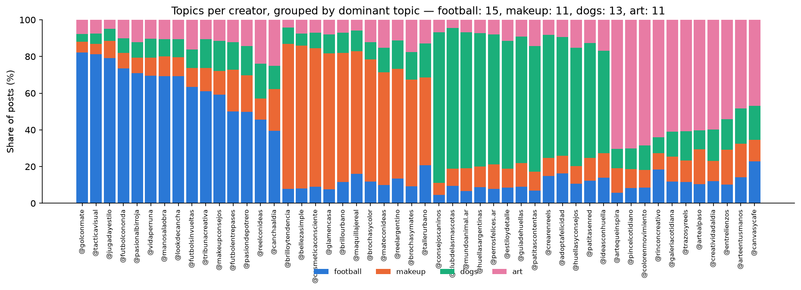

### Selección de variables

| Variable(s) | Decisión | Motivo |
|---|---|---|
| `price_ars`, `total_engagement_per_1000`, `estimated_argentina_reach`, `organic_posts_pct` | **Se descartan** | Se calculan exactamente a partir de otras (error máx. 1e-9; `estimated_argentina_reach` se redondea a entero). No aportan información y duplicarían peso en las distancias. |
| 4 `topic_*` y 4 `content_*` | Se mantienen | Cada grupo suma 100 → 2 dependencias lineales exactas (λ ≈ 0 en PCA). En PCA solo agregan componentes nulas, y en Kohonen son la forma natural de describir el contenido. |
| `followers`, `average_reach`, `average_impressions`, `average_video_views`, `price_usd` | Se mantienen | Bloque de "tamaño" con r ≥ 0.9 (reach ~ video views r = 0.997). Muy redundantes, pero el enunciado pide Kohonen "en términos de todas sus variables". Se mide el efecto de sacarlas (sensibilidad, abajo). |
| `video_posts_pct`, `short_form_posts_pct`, `trend_posts_pct` | Se mantienen | Bloque de formato viral (r ≥ 0.95), mismo criterio. |

**Set final: las 27 variables no derivadas**, el mismo en PCA, Kohonen y Oja para que sean comparables.
Todas se estandarizan (z-score): las escalas van de % a cientos de miles de seguidores
(`eda/boxplot_raw.png` vs `eda/boxplot_standardized.png`), y sin estandarizar el alcance dominaría
cualquier distancia.

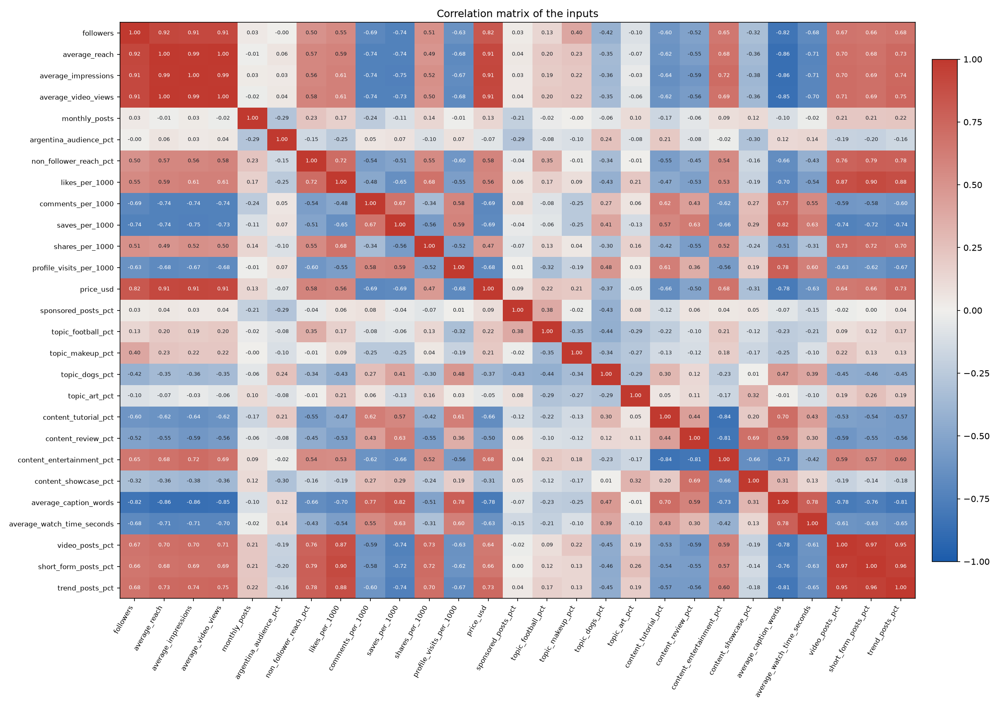

Lo que se ve en el EDA sobre `followers` (el criterio actual de la agencia):

- correlaciona con alcance (+0.92) y precio (+0.82), pero **no con el % de audiencia argentina (−0.00)**,
  y negativamente con saves (−0.74), visitas al perfil (−0.63), % de tutoriales (−0.60) y tiempo de
  reproducción (−0.69). Más seguidores implica más alcance y precio, no una audiencia más relevante ni
  más comprometida.

### PCA

Sobre la matriz de correlación de las 27 variables (`pca/eigenvalues.csv`, `pca/loadings.csv`):

| | λ | % | acumulado |
|---|---|---|---|
| PC1 | 13.42 | 49.7% | 49.7% |
| PC2 | 2.48 | 9.2% | 58.9% |
| PC3 | 1.89 | 7.0% | 65.9% |
| PC4–PC6 | 1.58, 1.32, 1.22 | 15.2% | 81.1% |

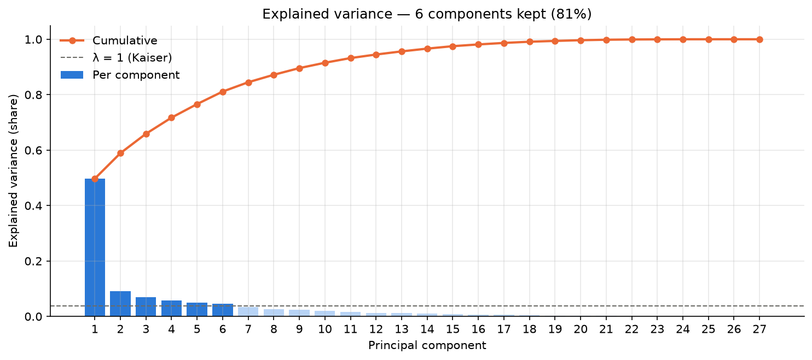

**Interpretación** (cargas en `pca/loadings.png`, con la orientación `max_loading_positive`):

- **PC1 (49.7%) = tamaño/formato viral ↔ profundidad.** Negativo: alcance, impresiones, vistas,
  followers, precio, % trend/video/short, entretenimiento. Positivo: palabras del caption, saves,
  comentarios, visitas al perfil, watch time, tutoriales/reseñas. Correlación de PC1 con log(followers): −0.91.
- **PC2 (9.2%) = showcase + arte ↔ audiencia argentina + perros.** Positivo: `content_showcase_pct`,
  `topic_art_pct`, likes; negativo: `argentina_audience_pct`, `topic_dogs_pct`, entretenimiento.
- **PC3 (7.0%) = patrocinio + fútbol ↔ perros.** `sponsored_posts_pct` +0.53, `topic_football_pct` +0.48,
  `topic_dogs_pct` −0.34.

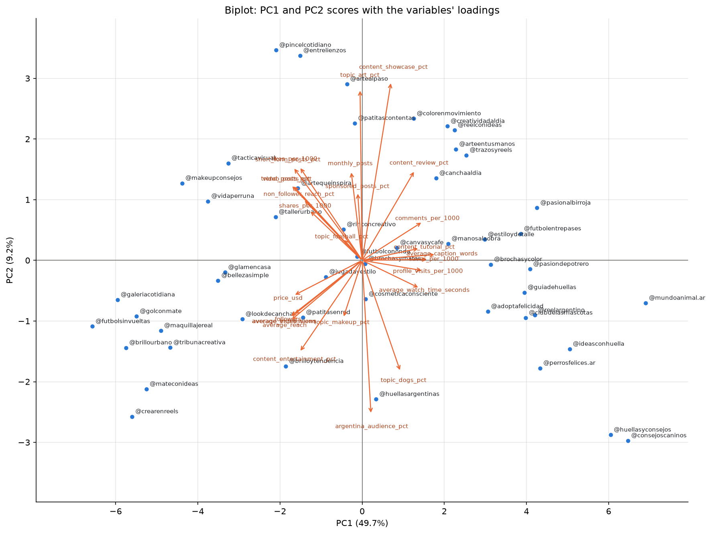

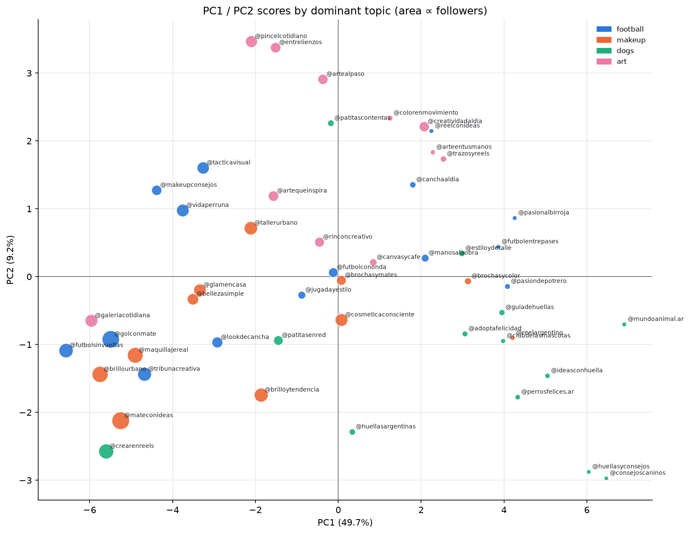

En el plano PC1/PC2 por temática (`pca/scores_by_topic.csv`), **PC1 no separa temáticas:
separa tamaño**. Los creadores masivos de las cuatro temáticas quedan juntos a la izquierda
(`@golconmate`, `@futbolsinvueltas`, `@mateconideas`, `@brillourbano`, `@crearenreels`,
`@galeriacotidiana`). A la derecha quedan los chicos y profundos, sobre todo perros (PC1 medio +2.76).
La temática aparece en PC2 (arte +1.74, perros −1.18) y PC3 (fútbol +1.33, perros −1.00).

**¿Reducir la dimensionalidad?** Para *interpretar*, sí: PC1 y PC2 resumen el 59% y Kaiser se queda
con 6 PCs (81%). Para *agrupar*, no: el 19% que queda fuera incluye diferencias de temática y de
audiencia que importan para la campaña, y con 50 creadores el costo de usar 27 variables es despreciable.
Kohonen y Oja usan las 27 variables estandarizadas. PCA sirve de referencia para interpretarlos.

---

## 1.2 Kohonen

### Elección de hiperparámetros

Barrido k ∈ {3, 4, 5, 6, 8} × η₀ ∈ {0.1, 0.5, 0.9} × R₀ ∈ {1, k/2, k} × 3 semillas, con η y R
lineales (η → 0.01, R → 1), vecindad step, grilla rectangular, inicialización con muestras y 500 épocas
(`kohonen/sweep_summary.csv`).

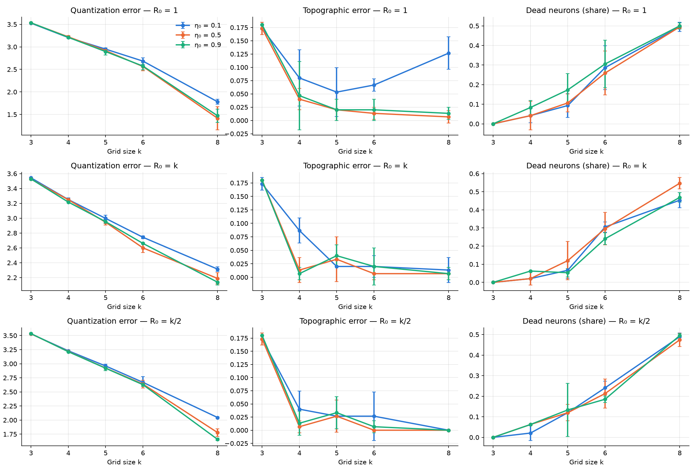

| k | mejor (η₀, R₀) | QE | TE | neuronas muertas |
|---|---|---|---|---|
| 3 | 0.1, 1 | 3.53 | 0.173 | 0% |
| 4 | 0.9, k | 3.22 | 0.007 | 6% |
| **5** | **0.5, k/2** | **2.92** | **0.027** | **12%** |
| 6 | 0.5, k/2 | 2.64 | 0.000 | 21% |
| 8 | 0.5, k/2 | 1.78 | 0.000 | 47% |

- **El QE siempre baja con k**: con más neuronas que creadores, cada neurona termina copiando a uno
  solo. Con k = 8 hay 64 neuronas para 50 creadores y la mitad queda muerta: el QE bajo no es una
  mejor generalización. Por eso no alcanza con mirar el QE.
- k = 3 tiene TE 0.17: 9 neuronas no alcanzan para 4 temáticas × tamaños, y el mapa se pliega.
- η₀ = 0.1 da peor TE (el mapa no llega a ordenarse); η₀ ∈ {0.5, 0.9} son equivalentes.
- R₀ = 1 ordena peor y es más variable entre semillas. k/2 y k dan resultados parecidos.

**Elección: k = 5 (25 neuronas, ~2 creadores por neurona), η 0.5 → 0.01, R 2.5 → 1**
(`res/config/kohonen_final.json`). Es el punto donde el TE ya es bajo y todavía quedan pocas neuronas
muertas. Con seed 42: QE 2.95, TE 0.06, 2/25 neuronas muertas. QE y TE se estabilizan bastante antes
de las 500 épocas (`kohonen/training.png`).

### Grilla, distribución y matriz U

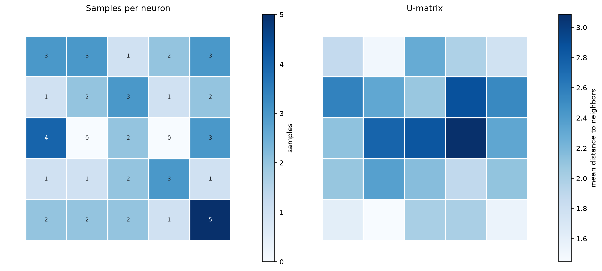

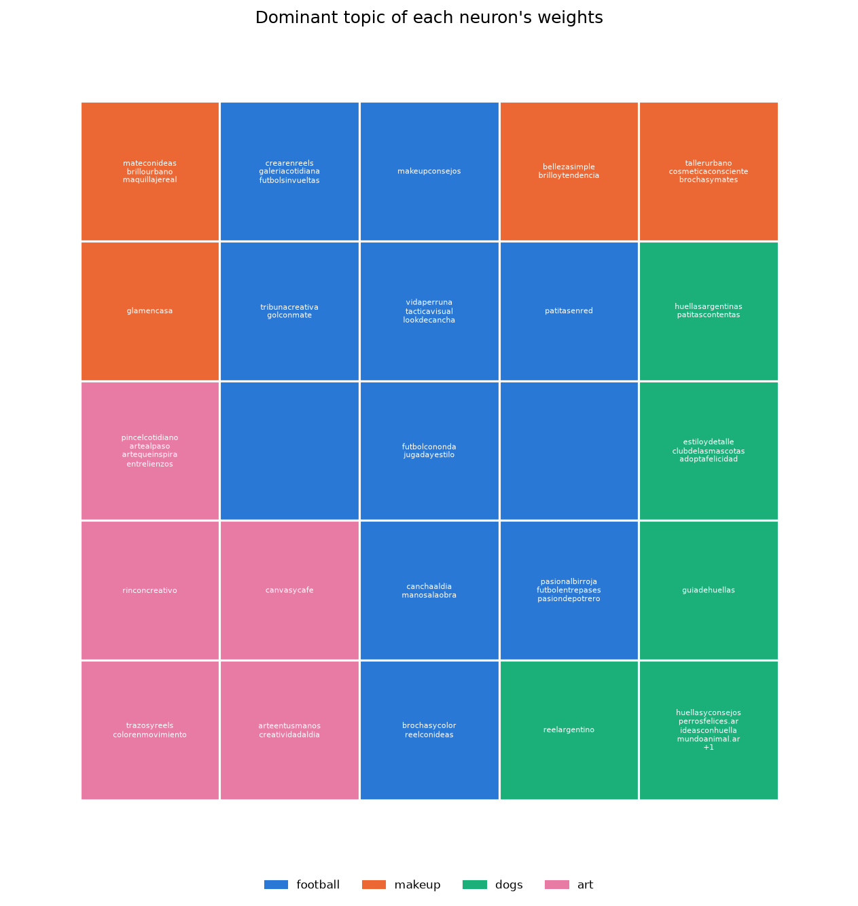

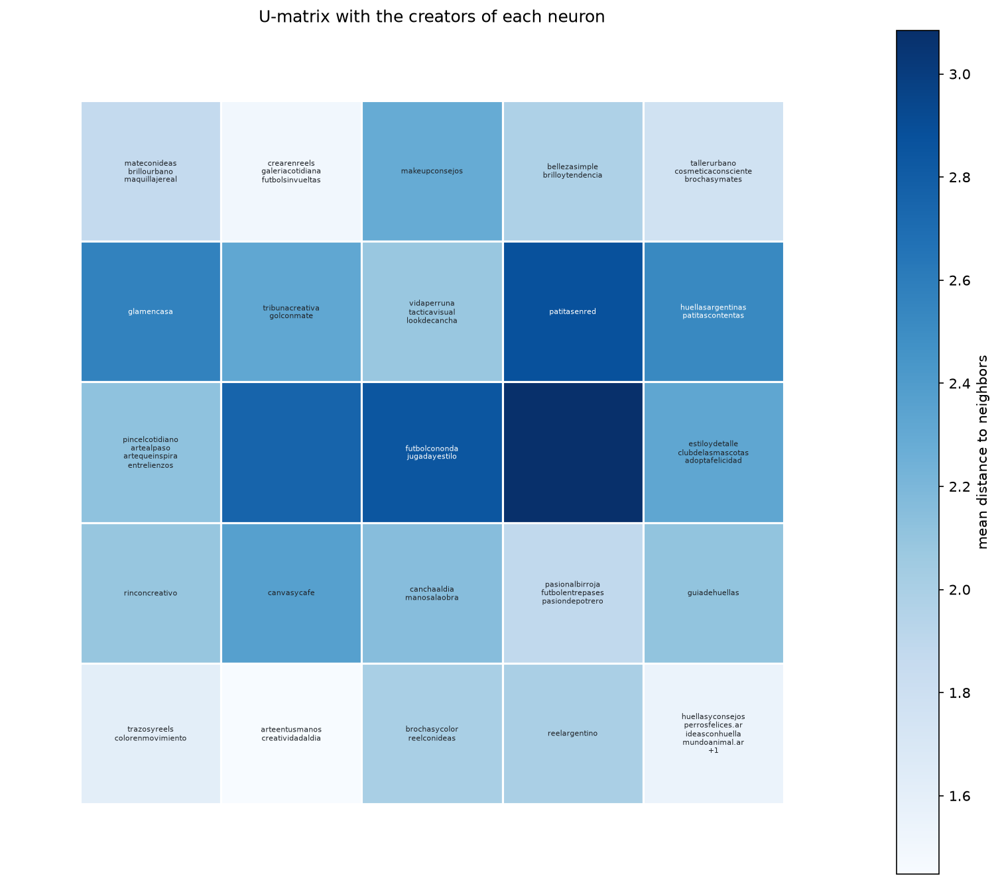

Los creadores se reparten entre 1 y 5 por neurona. El 94% comparte la temática mayoritaria de su
neurona (`kohonen/neurons.csv`). Las regiones:

- **Filas superiores (0–1) = creadores masivos**, mezclando temáticas: (0,0) `@mateconideas`,
  `@brillourbano`, `@maquillajereal`; (0,1) `@crearenreels` (perros), `@galeriacotidiana` (arte),
  `@futbolsinvueltas` (fútbol); (1,1) `@tribunacreativa`, `@golconmate`. En el extremo de tamaño el
  mapa agrupa por formato y alcance antes que por temática.
- **Esquina inferior derecha = perros nicho/educativo**: (4,4) `@huellasyconsejos`,
  `@perrosfelices.ar`, `@ideasconhuella`, `@mundoanimal.ar`, `@consejoscaninos`, y la columna derecha
  hacia arriba (refugios/adopción).
- **Columna izquierda, filas 2–4 = arte** (showcase); (2,0) junta los 4 de arte medianos.
- **Centro / abajo = fútbol mediano y educativo**: (3,3) `@pasionalbirroja`, `@futbolentrepases`,
  `@pasiondepotrero`; (3,2) `@canchaaldia`, `@manosalaobra`.
- **Maquillaje** queda arriba (masivo) y en la fila 0 hacia la derecha (mediano).

Mismo análisis en términos de campaña: el puntaje de cada objetivo (§1.4) evaluado en los pesos de cada
neurona (`kohonen/objectives.png`). Alcance y descubrimiento crecen hacia arriba a la izquierda;
profundidad y conversión, hacia abajo a la derecha.

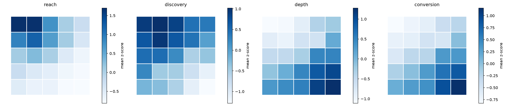

**¿Qué indica una distancia alta en la matriz U?** La matriz U es la distancia media entre los pesos
de una neurona y los de sus vecinas en la grilla. Si es alta, dos neuronas contiguas en el mapa
representan perfiles muy distintos en el espacio de las 27 variables: es una **frontera entre grupos**.
Si es baja, la región es homogénea y los creadores son intercambiables. Las fronteras más marcadas están
en el centro del mapa, entre el fútbol masivo/viral de arriba y el fútbol mediano/educativo de abajo:
(1,3)↔(2,3) = 4.47 y (2,2)↔(2,3) = 3.60, donde (2,3) es una neurona muerta. También entre fútbol y arte
(2,1)↔(3,1) = 3.49. Las zonas más homogéneas son las esquinas: arte (4,0)↔(4,1) = 1.32, maquillaje
masivo y fútbol masivo (0,0)↔(0,1) = 1.11. Para la agencia, dos creadores de la misma neurona o de
vecinas con U bajo son **reemplazos razonables** (si uno no está disponible). Cruzar una frontera de U
alto cambia de perfil aunque la temática sea la misma: fútbol viral ≠ fútbol educativo.

### ¿Coinciden con PC1 y PC2?

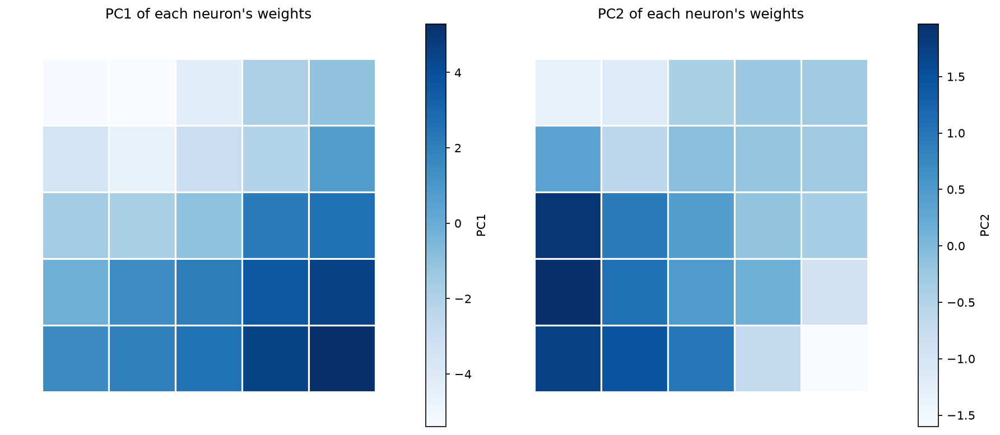

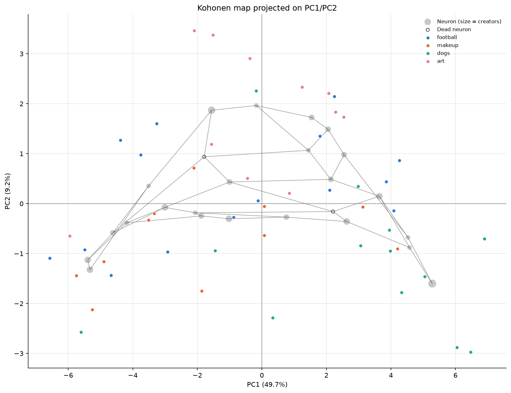

Sí, en gran parte. Proyectando los pesos de cada neurona sobre las PCs, **PC1 crece hacia abajo en la
grilla (r(PC1, fila) = +0.82)**: arriba los masivos (PC1 ≈ −5), abajo los profundos (PC1 ≈ +5).
**PC2 crece hacia la izquierda (r(PC2, columna) = −0.55)**: arte (PC2 ≈ +1.9) a la izquierda,
perros (PC2 ≈ −1.6) a la derecha. Es lo mismo que el biplot. Dibujado sobre el plano PC1/PC2, el mapa
queda como una red estirada que cubre la nube de creadores. Kohonen además separa cosas que PC1/PC2
mezclan, por ejemplo fútbol de maquillaje entre los medianos, porque usa toda la información (PC3 y siguientes).

### Robustez (`kohonen/stability.csv`)

- **Entre semillas** (10 semillas, misma config): QE 2.78–2.94, TE 0–0.06, 2–7 neuronas muertas,
  pureza temática 80–94%. El mapa puede salir rotado o reflejado, así que no se comparan posiciones
  sino qué pares de creadores quedan en la misma neurona o en vecinas. Jaccard medio entre semillas 0.47
  (0.33–0.70). La partición fina cambia, pero las regiones grandes (masivos, perros nicho, arte, fútbol
  educativo) se mantienen.
- **Con 22 variables** (sin followers, impressions, video views, video posts ni trend posts): QE 2.74,
  TE 0.04, pureza 88%, Jaccard 0.40 con el mapa final, que es del orden de la variación entre
  semillas. Sacar el bloque redundante no cambia la estructura, solo le quita algo de peso al "tamaño".
- **Creador nuevo** (leave-one-out: se entrena sin él y se lo ubica con la media/desvío guardados):
  en el 64% de los casos cae en una neurona cuya temática dominante es la suya, y en el 70% queda entre
  creadores de su temática. Los que fallan son creadores medianos o mixtos de la zona central
  (`@futbolcononda`, `@jugadayestilo`, `@patitasenred`) o masivos, donde el mapa agrupa por tamaño.

---

## 1.3 Índice con la regla de Oja

Una neurona lineal con la regla de Oja (`s = x·w`, `Δw = η s (x − s w)`) sobre las 27 variables
estandarizadas, η = 0.001, 500 épocas (`res/config/oja.json`).

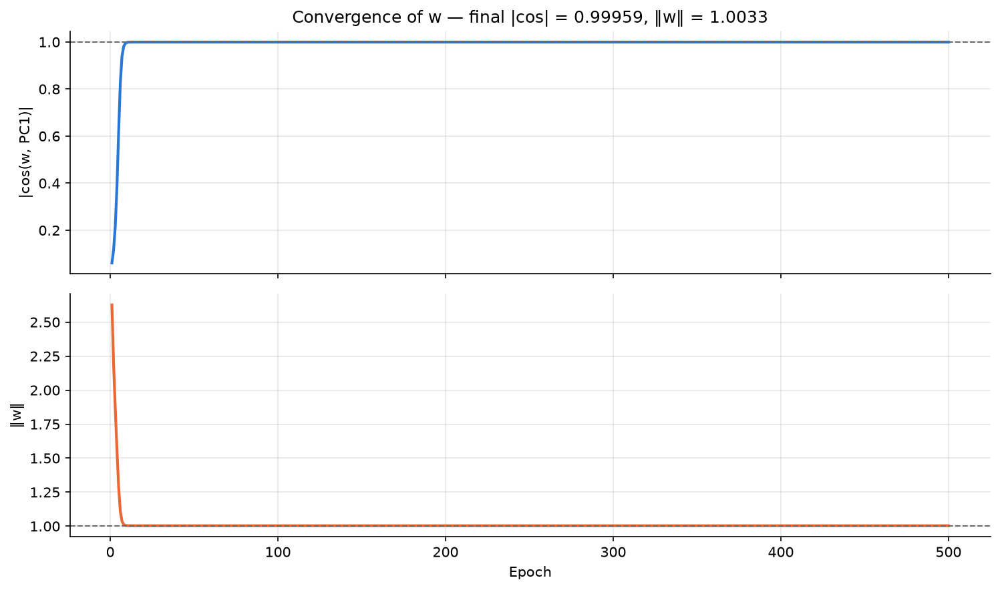

| | resultado |
|---|---|
| ‖w‖ | 1.0033 (la regla normaliza sola) |
| cos(w, PC1) | 0.99959 (1.6°) |
| var(índice) vs λ₁ | 13.50 vs 13.42 |
| Pearson / Spearman con PC1 | 0.99996 / 1.000 (mismo ranking) |
| máx \|índice − score PC1\| | 0.083 |

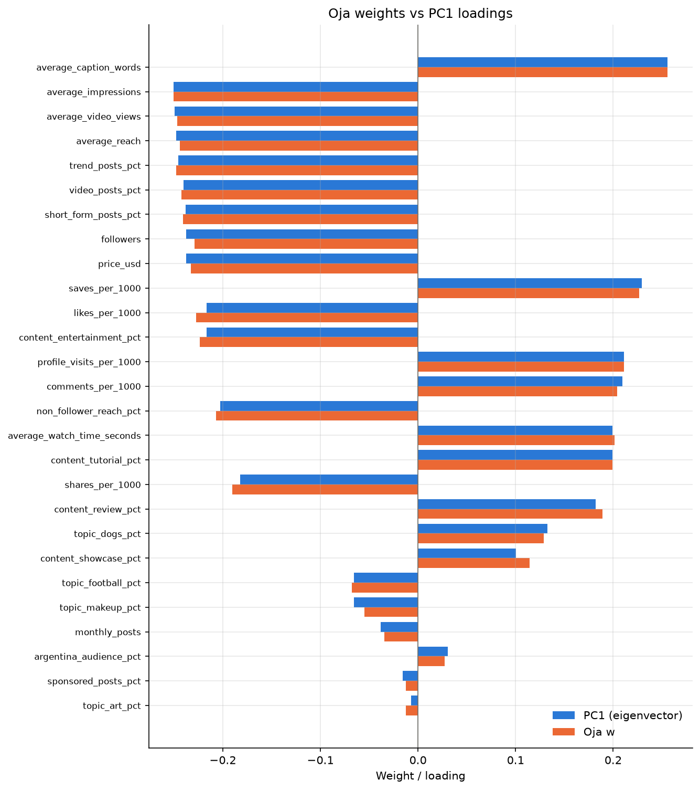

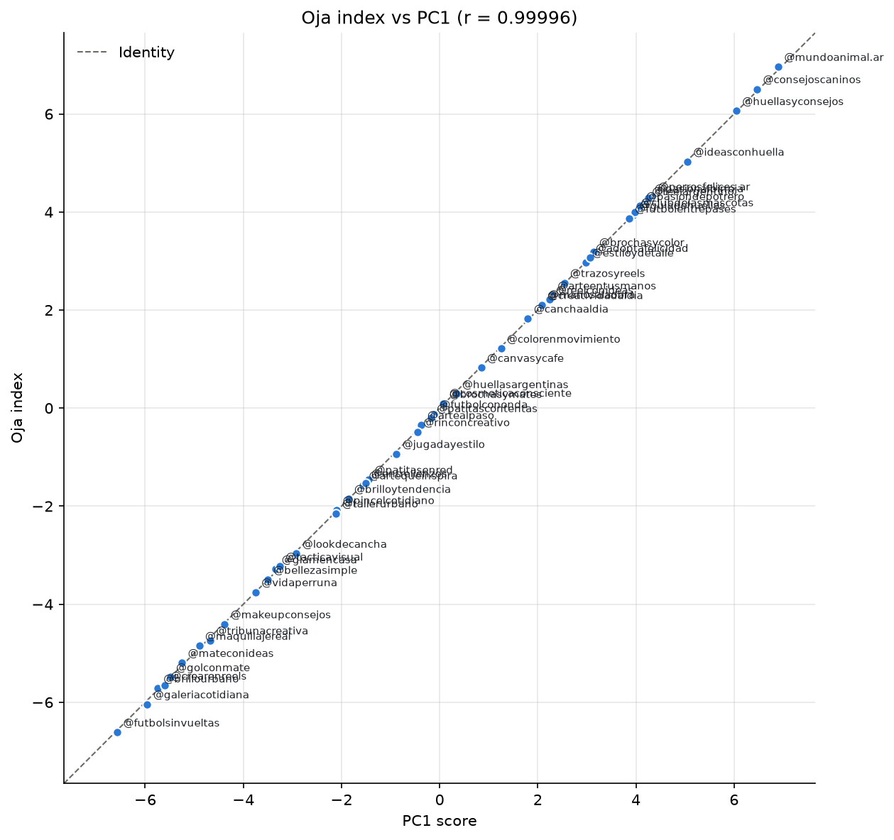

**Learning rate** (`oja/learning_rates.csv`). Con η constante, el punto fijo queda sesgado por η, y la
estabilidad pide η·‖x‖² ≲ 1 (máx ‖x‖² = 60):

| η | ‖w‖ | cos(w, PC1) | épocas hasta \|cos\| ≥ 0.99 |
|---|---|---|---|
| 0.06 (≈ 1/(1.2 λ₁)) | 1.21 | 0.669 | nunca |
| 0.01 | 1.036 | 0.982 | nunca |
| 0.005 | 1.018 | 0.993 | 2 |
| **0.001** | **1.003** | **0.9996** | **9** |
| 0.0001 | 1.0003 | 0.999996 | 87 |

Con 0.001 se obtiene casi el mismo resultado que con 0.0001 y converge 10 veces más rápido.

**¿Qué representa el índice?** Es la proyección de cada creador sobre la dirección de máxima varianza
de los datos, o sea su score en PC1 calculado con una red neuronal en vez de diagonalizar la matriz de
correlación. Mide **dónde está el creador en el eje tamaño/viral ↔ profundidad**.

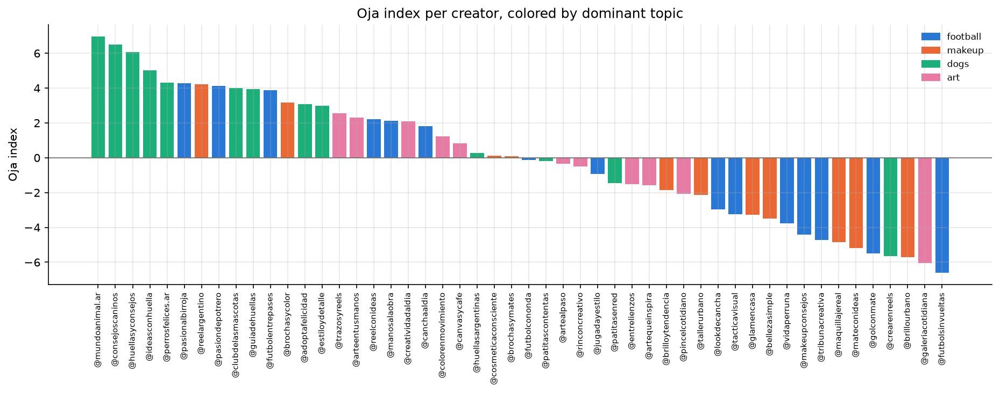

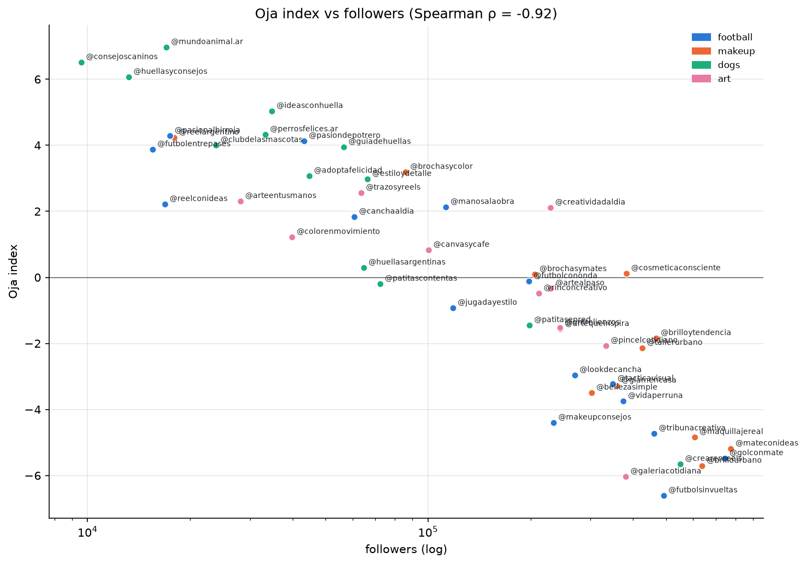

- Índice alto: `@mundoanimal.ar` (+6.96), `@consejoscaninos`, `@huellasyconsejos`, `@ideasconhuella`,
  `@perrosfelices.ar` (perros nicho, educativos, audiencia comprometida), seguidos por fútbol educativo
  (`@pasionalbirroja` +4.28).
- Índice bajo: `@futbolsinvueltas` (−6.61), `@galeriacotidiana`, `@brillourbano`, `@crearenreels`,
  `@golconmate` (los masivos de todas las temáticas).
- Spearman(índice, followers) = −0.92: es prácticamente el ranking de seguidores dado vuelta.

**¿Conviene elegir siempre al creador con el índice más alto?** No:

1. **El signo es arbitrario.** w y −w son igual de válidos (la regla converge a ±v₁). Acá se alineó
   con PC1, pero con otra inicialización el "máximo" sería `@futbolsinvueltas`. El índice ordena, pero no
   dice qué extremo es "mejor".
2. **Resume una sola dirección (49.7% de la varianza)** y no incluye la temática. El máximo es un
   creador de perros: sería una mala elección para una marca de maquillaje o de fútbol. Dentro de cada
   temática el índice va de −6 a +4 (`oja/index_by_topic.csv`).
3. **Cada objetivo pide un extremo distinto.** Una campaña de alcance busca el índice bajo (masivo) y
   una de profundidad busca el alto. El índice sirve para ubicar a un creador en el eje, una vez que se
   filtró por temática y se definió el objetivo, no como ranking universal.

---

## 1.4 Decisiones para las campañas

Método (`src/tp4/analysis/campaigns.py`): (1) candidatos = creadores cuya temática dominante es la del
cliente (equivale a la región del mapa de Kohonen con esa temática); (2) dentro de los candidatos,
ranking por el objetivo. Cada objetivo se mide como la media de z-scores de sus variables:

| Objetivo | Variables |
|---|---|
| Alcance masivo | `average_reach`, `estimated_argentina_reach` |
| Descubrimiento | `non_follower_reach_pct`, `shares_per_1000`, `trend_posts_pct`, `short_form_posts_pct` |
| Profundidad educativa | `content_tutorial_pct`, `saves_per_1000`, `average_watch_time_seconds`, `average_caption_words`, `comments_per_1000` |
| Conversión | `profile_visits_per_1000`, `comments_per_1000`, `saves_per_1000`, `argentina_audience_pct` |

"Alcance dirigido" = alcance argentino estimado × % de posts sobre la temática del cliente.

### Fútbol: ¿alcance, descubrimiento o profundidad?

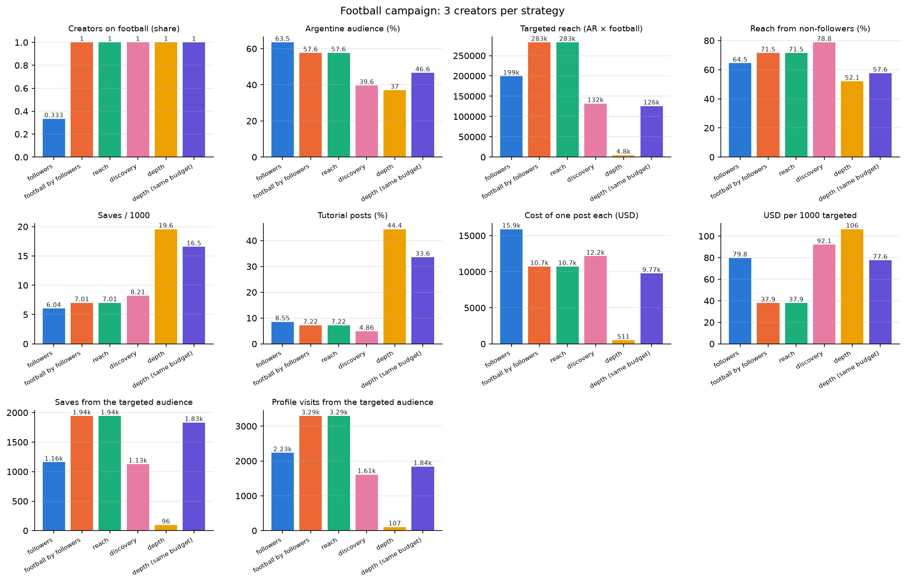

| Estrategia (3 creadores) | Creadores | Alcance dirigido | Saves/1000 | % tutorial | Costo (USD) | USD / 1000 dirigidos |
|---|---|---|---|---|---|---|
| Followers (actual) | @mateconideas, @golconmate, @brillourbano | 199k | 6.0 | 8.5 | 15 897 | 79.8 |
| Alcance | @golconmate, @tribunacreativa, @futbolsinvueltas | 283k | 7.0 | 7.2 | 10 713 | 37.9 |
| Descubrimiento | @makeupconsejos, @futbolsinvueltas, @tribunacreativa | 132k | 8.2 | 4.9 | 12 156 | 92.1 |
| Profundidad | @reelconideas, @pasionalbirroja, @futbolentrepases | 4.8k | 19.6 | 44.4 | 511 | 106.4 |
| Profundidad, mismo presupuesto (9) | los 9 más profundos de fútbol | 126k | 16.5 | 33.6 | 9 766 | 77.6 |

Entre los creadores de fútbol, alcance y profundidad son **opuestos** (r = −0.84 entre los dos
puntajes). Es el eje PC1/Oja: el índice correlaciona +0.96 con profundidad y −0.85 con alcance
(`campaigns/football_creators.csv`). No hay un creador que maximice todo, y por eso la elección depende
del objetivo:

- **Recomendación para ropa de entrenamiento de fútbol: profundidad educativa como base, con alcance
  como complemento.** Ropa de entrenamiento es un producto que se elige por uso (ejercicios, rutinas,
  calce), y los creadores educativos tienen 2.8× más saves y 6× más tutoriales. Los saves y las visitas
  al perfil son la señal de intención de compra más cercana que hay en el dataset. Cada post cuesta
  ~170 USD contra ~3 500 USD, así que con el presupuesto de 3 masivos se contratan 9 educativos con un
  alcance dirigido del mismo orden (126k vs 283k), casi los mismos saves dirigidos (1.83k vs 1.94k) y
  audiencia que vuelve al contenido.
- **Alcance masivo** conviene si el objetivo es awareness (un lanzamiento): es el más barato por
  persona alcanzada (37.9 USD/1000), pero con poco engagement.
- **Descubrimiento** (viral, no seguidores) da el mayor % de alcance fuera de los seguidores (79%),
  pero es el más caro por persona dirigida y tiene la audiencia menos argentina (40%).
- En el mapa, la región de fútbol educativo es (3,2)–(3,3)–(4,2). Si un creador no está disponible,
  sus vecinos en el mapa son alternativas de perfil parecido.

### Comparación con la estrategia por followers

El top-3 por followers es el mismo para cualquier cliente: `@mateconideas` (maquillaje),
`@golconmate` (fútbol), `@brillourbano` (maquillaje). Por cliente (`campaigns/clients.csv`):

| Cliente | Followers: en temática | USD/1000 dirigidos | Por perfil: en temática | USD/1000 dirigidos |
|---|---|---|---|---|
| Fútbol | 1/3 | 79.8 | 3/3 (alcance) | 37.9 |
| Maquillaje | 2/3 | 84.8 | 3/3 (profundidad) | 46.7 |
| Refugios de perros | **0/3** | **365.9** | 3/3 (conversión) | 56.1 |
| Materiales de arte | **0/3** | **304.0** | 3/3 (alcance) | 52.3 |

- **Ventajas de followers:** es simple y barato de mantener, maximiza la visibilidad bruta (2.16M
  seguidores, 750k de alcance) y es fácil de explicar.
- **Desventajas:** ignora la temática y la audiencia. Es justo el problema de la agencia: hay
  visibilidad pero no llega al público objetivo. Para refugios y arte, ninguno de los 3 habla de su
  temática, y el costo por persona relevante es 5–7× más alto. Además son los creadores más caros y
  con peor engagement (followers ~ saves r = −0.74).
- **Ventajas de la selección por perfil:** cada cliente recibe creadores de su temática y de su
  objetivo. Para **refugios** (consultas/adopciones) la conversión prioriza visitas al perfil,
  comentarios y audiencia argentina: `@ideasconhuella` (83% AR, 27 visitas/1000), `@mundoanimal.ar`,
  `@huellasyconsejos` (94% AR), a 75–110 USD por post (`campaigns/dogs_creators.csv`).
- **Desventajas:** menor alcance bruto, depende de supuestos (qué variables miden cada objetivo,
  que el interés de la audiencia es proporcional a la temática) y hay que mantenerlo.

### Mantenimiento del sistema

- **Llega una campaña nueva:** no hace falta reentrenar. Hay que definir el cliente (temática), el
  objetivo (qué variables lo miden) y elegir región del mapa + ranking. Es solo una consulta.
  Si el cliente es de una temática que no está en los datos, no hay forma de evaluar afinidad:
  hace falta una variable nueva.
- **Creadores nuevos (pocos):** se ubican con `predict` usando la media y el desvío guardados, sin
  reentrenar. El leave-one-out muestra que funciona en ~70% de los casos y falla en los perfiles mixtos.
  Si cambia mucho la cantidad (p. ej. de 50 a 500), hay que reestandarizar, **reentrenar y volver a
  elegir k** (más creadores permiten grillas más grandes sin tantas neuronas muertas) y rehacer el barrido.
- **Variables nuevas:** cambia la dimensión de los pesos. Hay que rehacer el EDA (¿es derivada?,
  ¿redundante?), PCA, reestandarizar y reentrenar Kohonen y Oja. Las interpretaciones de PC1 y de las
  regiones se tienen que volver a hacer.
- **Actualización mensual:** cambian media y desvío, y por eso el z-score de todos los creadores.
  Reentrenar es barato (segundos), pero **el mapa sale rotado/reflejado y con otra
  partición fina** (Jaccard 0.47 entre semillas), y el signo de Oja/PC1 puede invertirse. Las regiones
  y el signo del índice se tienen que reetiquetar automáticamente (temática dominante de los pesos,
  alinear w con la PC1 del mes anterior). Conviene fijar la semilla e inicializar con los pesos del mes
  anterior para que el mapa no cambie solo por azar, y versionar config + resultados para comparar
  meses (un creador que cambia de región cambió de perfil).
